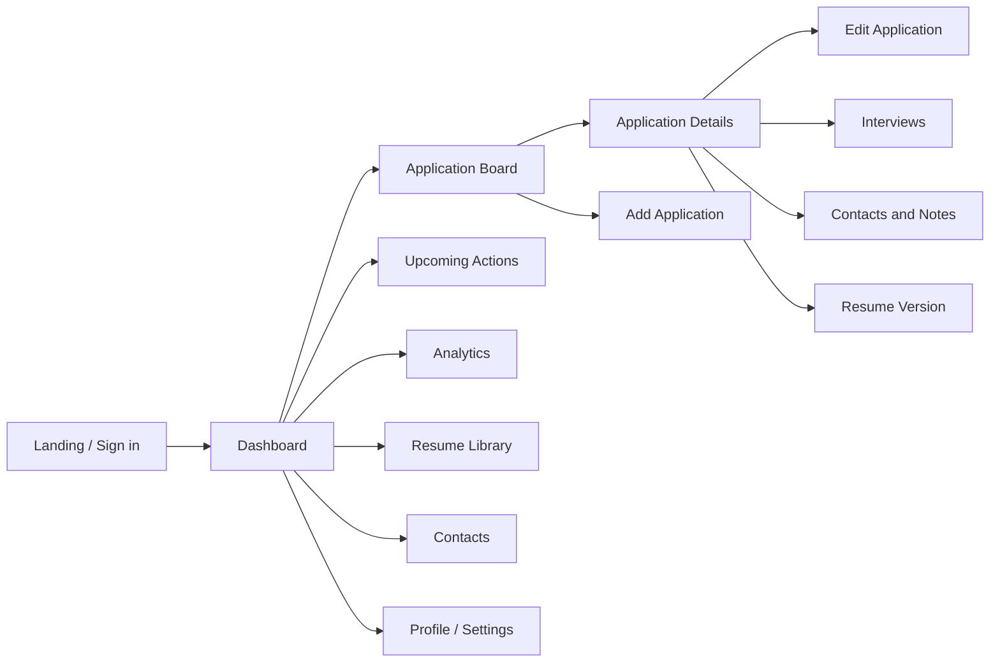
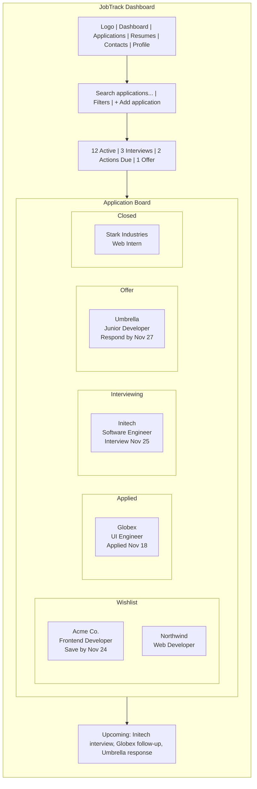
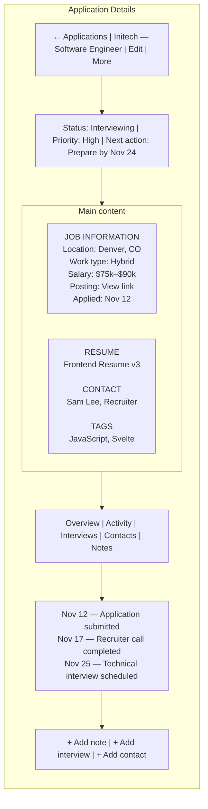
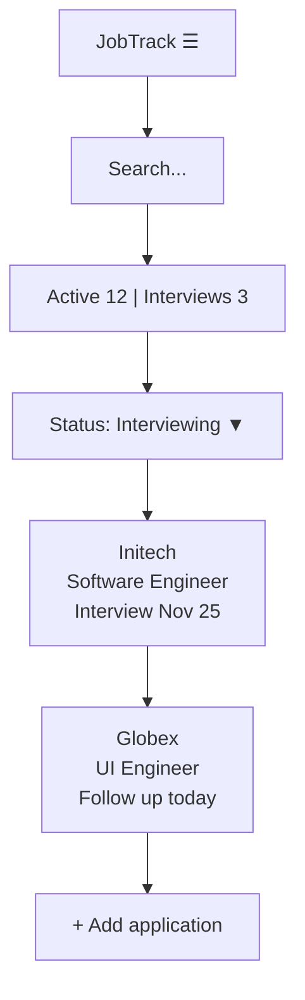
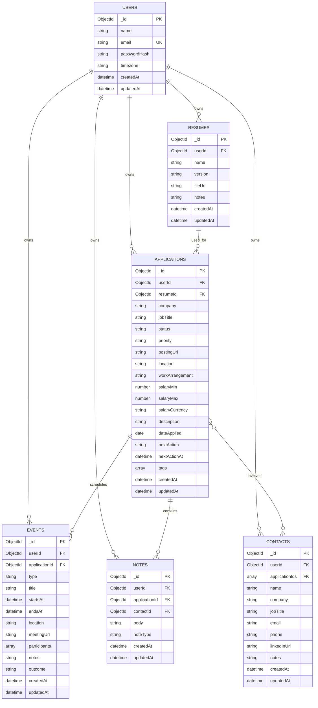

# Team Project Proposal

## Project description

We will build a job application tracker that gives job seekers one place to organize their search. Users will be able to save job opportunities, move applications through a visual board, associate each application with a version of their resume, record recruiter and company contacts, keep notes, and track interviews and follow-up dates. The application will replace scattered spreadsheets, calendar entries, and documents with a focused dashboard that shows what needs attention next.

## Team members

- Roger Galan
- Cassidy Whitehead
- Jesus Tortolero Hernandez

## Technologies

- **Front end:** Svelte, JavaScript, HTML, and CSS
- **Back end:** Node.js and Express
- **Database:** MongoDB with Mongoose
- **API style:** REST with JSON request and response bodies
- **Authentication:** Session cookies or JSON Web Tokens (JWT), with hashed passwords
- **Development tools:** Git/GitHub, npm, ESLint, Prettier, and Postman/Bruno for API testing
- **Deployment:** A static front-end host and a Node-compatible API host, with MongoDB Atlas for the production database

## Team management and communication strategy

- Use a Microsoft Teams channel for day-to-day communication, questions, meeting notes, and decisions.
- Hold a short weekly planning meeting to select work for the week and identify blockers.
- Track features and bugs as GitHub issues on a shared Trello project board using **Backlog**, **In Progress**, **Review**, and **Done** columns.
- Create feature branches and submit pull requests before merging into the main branch. At least one teammate should review each pull request.
- Agree on API contracts and database changes before implementation so the front end and back end can be developed in parallel.
- Keep the `README` updated with setup instructions, environment variables, scripts, and major architectural decisions.

## Core features

The following features make up the minimum viable product (MVP):

1. **User accounts and authorization**
   - Register, sign in, sign out, and remain signed in across page refreshes.
   - Hash passwords and protect private API routes.
   - Ensure users can only view and modify their own records.

2. **Application dashboard and board**
   - Display the user's applications in status columns: **Wishlist**, **Applied**, **Interviewing**, **Offer**, and **Closed**.
   - Create, view, edit, delete, and move an application between statuses.
   - Show company, role, location, date applied, next action, and deadline at a glance.
   - Provide a list view for users who prefer a compact table over the board.

3. **Application details**
   - Store the job posting URL, salary range, work arrangement, description, and personal notes.
   - Show a chronological activity history for important changes, such as applying, scheduling an interview, or receiving an offer.
   - Record a next-action label and due date so follow-ups are not forgotten.

4. **Resume version management**
   - Create resume records with a descriptive name, version, file/link location, and notes.
   - Associate one resume version with each application.
   - View which applications used a particular resume.

5. **Contacts and notes**
   - Save recruiters, hiring managers, referrals, and other contacts with name, title, email, phone, and LinkedIn URL.
   - Associate contacts with a company and one or more applications.
   - Add timestamped contact notes, such as conversations and promised follow-ups.

6. **Interview and follow-up tracking**
   - Add phone screens, interviews, assessments, and other events to an application.
   - Store the event type, date/time, location or meeting URL, participants, and preparation notes.
   - Display upcoming events and overdue actions on the dashboard.

7. **Search, filter, and sorting**
   - Search applications by company or job title.
   - Filter by status, date, location, work arrangement, and resume version.
   - Sort by newest, date applied, next action date, company, or role.

8. **Responsive and accessible interface**
   - Support desktop and mobile layouts.
   - Use semantic HTML, keyboard-accessible controls, clear focus indicators, form labels, and sufficient color contrast.
   - Provide useful empty, loading, success, validation, and error states.

## Additional features

These are stretch goals and will be considered after the core features are complete:

- Drag-and-drop cards between board columns, with a keyboard-accessible alternative.
- Summary analytics such as applications per week, response rate, interview rate, offer rate, and average time in each stage.
- Email or in-app reminders for interviews, deadlines, and overdue follow-ups.
- Calendar view and export to an `.ics` calendar file.
- Tags and saved filters for organizing searches by industry, priority, or skill set.
- Document upload to cloud storage rather than storing only resume links and metadata.
- Job-description snapshot so users retain the posting after it is removed from the original site.
- CSV import/export and a complete personal-data export.
- Reusable interview-question bank and post-interview reflection templates.
- Company research notes and links.
- Optional dark mode and customizable board statuses.
- A browser share/bookmark workflow for quickly adding a job posting.

## Wireframes and mockups

### Page flow



### Desktop dashboard and application board



### Application detail page



### Mobile layout



The Mermaid diagrams describe structure and user flow rather than final colors or typography. The finished interface will use reusable Svelte components for navigation, forms, dialogs, status columns, cards, filters, and feedback messages.

## Initial database schema

MongoDB will store related data in separate collections. Every user-owned document includes a `userId`; API queries must always include that value to prevent cross-account access. Mongoose will provide schema validation and timestamps.



### Collection details and validation

#### `users`

```js
{
  _id: ObjectId,
  name: String,                         // required, 1–100 characters
  email: String,                        // required, normalized, unique
  passwordHash: String,                 // required; never returned by the API
  timezone: String,                     // default: "America/Denver"
  createdAt: Date,
  updatedAt: Date
}
```

#### `applications`

```js
{
  _id: ObjectId,
  userId: ObjectId,                     // required, references users
  resumeId: ObjectId | null,            // optional, references resumes
  company: String,                      // required, max 150 characters
  jobTitle: String,                     // required, max 150 characters
  status: "wishlist" | "applied" | "interviewing" | "offer" | "closed",
  priority: "low" | "medium" | "high",
  postingUrl: String | null,
  location: String | null,
  workArrangement: "onsite" | "hybrid" | "remote" | null,
  salaryMin: Number | null,
  salaryMax: Number | null,
  salaryCurrency: String,               // default: "USD"
  description: String | null,
  dateApplied: Date | null,
  nextAction: String | null,
  nextActionAt: Date | null,
  tags: [String],
  closedReason: String | null,
  createdAt: Date,
  updatedAt: Date
}
```

#### `resumes`

```js
{
  _id: ObjectId,
  userId: ObjectId,
  name: String,                         // e.g. "Frontend Resume"
  version: String,                      // e.g. "v3"
  fileUrl: String | null,
  notes: String | null,
  createdAt: Date,
  updatedAt: Date
}
```

#### `contacts`

```js
{
  _id: ObjectId,
  userId: ObjectId,
  applicationIds: [ObjectId],
  name: String,
  company: String | null,
  jobTitle: String | null,
  email: String | null,
  phone: String | null,
  linkedInUrl: String | null,
  notes: String | null,
  createdAt: Date,
  updatedAt: Date
}
```

#### `events`

```js
{
  _id: ObjectId,
  userId: ObjectId,
  applicationId: ObjectId,
  type: "phone_screen" | "interview" | "assessment" | "follow_up" | "other",
  title: String,
  startsAt: Date,
  endsAt: Date | null,
  location: String | null,
  meetingUrl: String | null,
  participants: [String],
  notes: String | null,
  outcome: String | null,
  createdAt: Date,
  updatedAt: Date
}
```

#### `notes`

```js
{
  _id: ObjectId,
  userId: ObjectId,
  applicationId: ObjectId,
  contactId: ObjectId | null,
  noteType: "general" | "contact" | "status_change",
  body: String,
  createdAt: Date,
  updatedAt: Date
}
```

### Suggested indexes

- `users.email`: unique index for sign-in and duplicate prevention.
- `applications.userId + status + updatedAt`: supports board columns and recent sorting.
- `applications.userId + nextActionAt`: supports upcoming and overdue actions.
- `applications.userId + company + jobTitle`: supports user-scoped search.
- `resumes.userId + name + version`: unique compound index to prevent duplicate versions.
- `events.userId + startsAt`: supports the upcoming-events dashboard.
- `notes.applicationId + createdAt`: supports chronological activity display.
- All referenced IDs will be checked for ownership in the API; MongoDB references do not enforce foreign keys automatically.

## API endpoints

All endpoints are prefixed with `/api`. Protected endpoints require an authenticated user. Successful responses use JSON, appropriate HTTP status codes, and a consistent shape such as `{ "data": ... }`. Errors use `{ "error": { "code": "...", "message": "...", "fields": {} } }`.

### Authentication and profile

| Method | Endpoint | Purpose | Auth |
|---|---|---|---|
| `POST` | `/api/auth/register` | Create an account and start a session | No |
| `POST` | `/api/auth/login` | Authenticate with email and password | No |
| `POST` | `/api/auth/logout` | End the current session | Yes |
| `GET` | `/api/auth/me` | Return the current user's safe profile | Yes |
| `PATCH` | `/api/users/me` | Update name, email, or timezone | Yes |
| `PATCH` | `/api/users/me/password` | Change the current user's password | Yes |

### Applications

| Method | Endpoint | Purpose |
|---|---|---|
| `GET` | `/api/applications` | List the user's applications with search, filters, sorting, and pagination |
| `POST` | `/api/applications` | Create an application |
| `GET` | `/api/applications/:applicationId` | Get one application and its related summary data |
| `PATCH` | `/api/applications/:applicationId` | Update application fields |
| `PATCH` | `/api/applications/:applicationId/status` | Move an application to another board status |
| `DELETE` | `/api/applications/:applicationId` | Delete an application and its dependent events/notes |

Example list query:

```text
GET /api/applications?status=interviewing&search=developer&sort=nextActionAt&page=1&limit=20
```

### Resumes

| Method | Endpoint | Purpose |
|---|---|---|
| `GET` | `/api/resumes` | List resume versions and application-use counts |
| `POST` | `/api/resumes` | Create resume metadata or upload a resume if uploads are implemented |
| `GET` | `/api/resumes/:resumeId` | Get one resume and the applications that use it |
| `PATCH` | `/api/resumes/:resumeId` | Update resume name, version, link, or notes |
| `DELETE` | `/api/resumes/:resumeId` | Delete an unused resume or require reassignment first |

### Contacts

| Method | Endpoint | Purpose |
|---|---|---|
| `GET` | `/api/contacts` | List/search the user's contacts |
| `POST` | `/api/contacts` | Create a contact and optionally associate applications |
| `GET` | `/api/contacts/:contactId` | Get a contact and related applications/notes |
| `PATCH` | `/api/contacts/:contactId` | Update a contact |
| `DELETE` | `/api/contacts/:contactId` | Delete a contact without deleting its applications |
| `PUT` | `/api/applications/:applicationId/contacts/:contactId` | Associate a contact with an application |
| `DELETE` | `/api/applications/:applicationId/contacts/:contactId` | Remove the association |

### Interviews and events

| Method | Endpoint | Purpose |
|---|---|---|
| `GET` | `/api/events` | List events; supports `from`, `to`, `type`, and `applicationId` filters |
| `POST` | `/api/applications/:applicationId/events` | Add an interview, assessment, or follow-up |
| `GET` | `/api/events/:eventId` | Get an event |
| `PATCH` | `/api/events/:eventId` | Reschedule or update an event/outcome |
| `DELETE` | `/api/events/:eventId` | Delete an event |

### Notes and activity

| Method | Endpoint | Purpose |
|---|---|---|
| `GET` | `/api/applications/:applicationId/notes` | List application notes chronologically |
| `POST` | `/api/applications/:applicationId/notes` | Add a general or contact note |
| `PATCH` | `/api/notes/:noteId` | Edit a note |
| `DELETE` | `/api/notes/:noteId` | Delete a note |
| `GET` | `/api/applications/:applicationId/activity` | Return a combined timeline of notes, events, and status changes |

### Dashboard

| Method | Endpoint | Purpose |
|---|---|---|
| `GET` | `/api/dashboard/summary` | Return counts by status, upcoming events, and overdue actions |
| `GET` | `/api/dashboard/analytics` | Return funnel and trend data; may be deferred as a stretch feature |

### API behavior and security requirements

- Validate request bodies, route parameters, query parameters, and allowed enum values on the server.
- Return `201 Created` for successful creation, `204 No Content` for successful deletion, `400` for invalid input, `401` for unauthenticated requests, `403` for forbidden access, `404` for missing user-owned resources, and `409` for conflicts such as duplicate email addresses.
- Never accept a `userId` from the client for user-owned records; derive it from the authenticated session/token.
- Check that referenced resumes, applications, and contacts belong to the current user.
- Hash passwords with a modern password-hashing library, use secure cookie settings when cookie-based authentication is selected, rate-limit authentication routes, and keep secrets in environment variables.
- Limit page sizes and sanitize error responses so internal stack traces and database details are not exposed.
